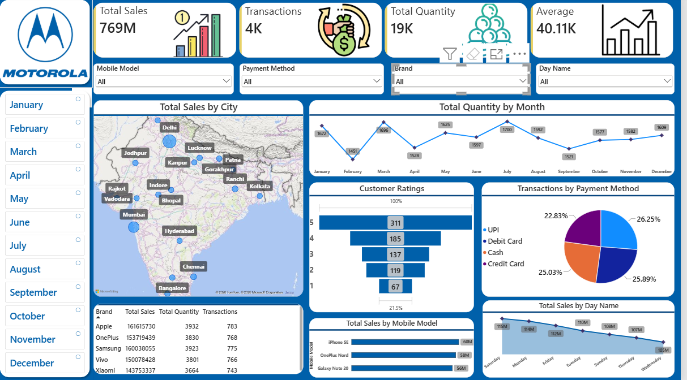

# 📱 Mobile Sales Analysis Dashboard | Power BI

## 📌 Project Overview
An interactive Power BI dashboard designed to analyze mobile sales performance, customer purchasing patterns, payment preferences, and geographical sales distribution.

## 🛠️ Tools & Technologies
- Microsoft Power BI
- DAX
- Power Query
- Data Visualization
- Business Intelligence

## 📊 Dashboard Preview

## 📈 Key Performance Indicators
- Total Sales
- Total Transactions
- Total Quantity Sold
- Average Sales Metric

## 🔍 Key Insights & Analysis
- Sales performance across different cities
- Monthly quantity trends
- Brand and mobile model comparisons
- Customer rating distribution
- Transactions by payment method
- Sales performance by day of the week

## 🎛️ Interactive Features
- Month selection
- Mobile model filtering
- Brand filtering
- Payment method filtering
- Day-of-week filtering

## 🚀 How to Use
1. Download the `.pbix` file from this repository.
2. Open it using Power BI Desktop.
3. Configure the data source if required.
4. Explore the dashboard using the available filters.

## 👨‍💻 Author
Ashutosh Sharma
